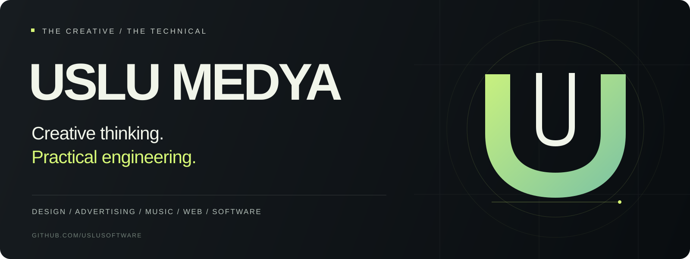

  

  <a href="https://www.usluyapim.com/">Website</a> &nbsp; / &nbsp;
  <a href="https://www.instagram.com/usluyapim/">Instagram</a> &nbsp; / &nbsp;
  <a href="https://tr.linkedin.com/company/uslu-yap%C4%B1m">LinkedIn</a> &nbsp; / &nbsp;
  <a href="mailto:usluyapimorg@gmail.com">Get in touch</a>

# Creative thinking. Practical engineering.

**We connect the way a brand looks, sounds, and works.**

Uslu Medya brings together design, advertising, music, and digital services. Alongside our creative work, we build websites and software and work with the hosting and email systems that support them.

This is our home on GitHub: a place for our engineering work, technical collaboration, and the standards we use to build with care.

## Where creativity meets implementation

| Creative work | Digital delivery |
| :--- | :--- |
| **Design** — visual communication that gives ideas a clear identity. | **Websites** — web design and development shaped around the brief. |
| **Advertising & promotion** — creative work that helps brands communicate. | **Software** — practical development for specific business needs. |
| **Music** — music and production as part of the creative experience. | **Hosting & email** — hands-on work with cPanel and professional email systems. |

## Our technical focus

**PHP · cPanel · Websites · Email systems**

We work across development and the systems around it. Our approach is to understand the need, keep the implementation maintainable, and make deployment and handover part of the work.

- **Start with the brief.** Connect technical decisions to the creative direction and the business need.
- **Build for the next person.** Prefer readable code, useful documentation, and clear ownership.
- **Verify before delivery.** Check the behavior that matters and record how a change was validated.
- **Handle access with care.** Keep credentials, client information, and production data out of public repositories.

## Explore our GitHub

[**Browse our public repositories →**](https://github.com/uslusoftware?tab=repositories)

Project-specific documentation, setup instructions, and contribution requirements belong in each project's own repository. This profile is the starting point for finding your way around our GitHub presence.

## Working with us

**Have a brief, a technical challenge, or an idea to discuss?** [Email us](mailto:usluyapimorg@gmail.com).

Development is primarily coordinated within our team. If you would like to contribute from outside the team, please discuss the scope with us before starting implementation.

| Guide | What you will find |
| :--- | :--- |
| [Contributing](CONTRIBUTING.md) | How to propose, prepare, and submit a change. |
| [Governance](GOVERNANCE.md) | Ownership, review, and how decisions are made. |
| [Code of conduct](CODE_OF_CONDUCT.md) | Expectations for respectful collaboration. |
| [Security](SECURITY.md) | How to report a concern privately. |
| [Support](SUPPORT.md) | Where to take project questions and business inquiries. |

---

  <strong>Uslu Medya</strong> 
  Design. Sound. Code.  
  <a href="mailto:usluyapimorg@gmail.com">usluyapimorg@gmail.com</a>

